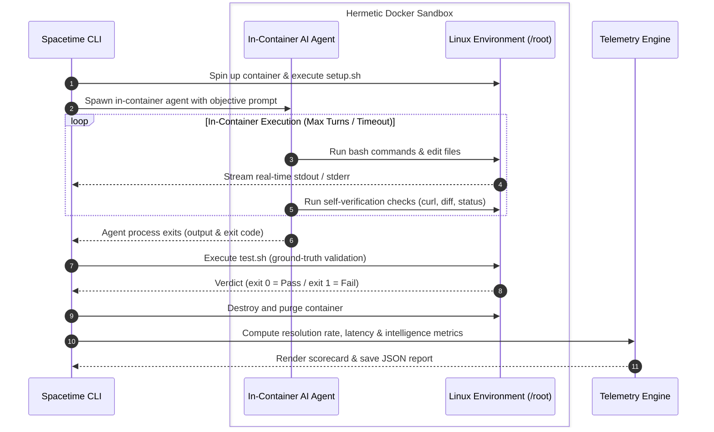

<p align="center">
  
</p>

<h4 align="center">a benchmark for evaluating coding agents on interactive terminal tasks</h4>

Spacetime evaluates AI agents inside isolated Docker containers on real terminal challenges like fixing broken Nginx servers, resolving Git conflicts, parsing logs, and repairing port clashes. Solutions are tested against strict test assertions to verify what actually works.

It runs agents through 50 embedded Linux environments covering sysadmin, networking, debugging, and data pipelines. Beyond basic pass/fail checks, Spacetime captures deep telemetry across the execution lifecycle—tracking pass rates, latency, turn efficiency, error recovery, token economics & cost, and self-verification behavior.

```bash
curl -fsSL https://spacetime.trydecember.com | bash
```


### How It Works

- Starts a fresh, isolated Docker container
- Gives the agent terminal access to fix the task
- Streams live terminal output in real time
- Runs automated tests to verify the solution
- Cleans up and generates the final scorecard

### Task Structure

Each task is self-contained with four simple files:
- `prompt.txt` - The objective presented to the agent
- `setup.sh` - Prepares the broken state inside the fresh container
- `test.sh` - Ground-truth test assertions
- `meta.sh` - Task metadata, timeout, and turn configuration



### Leaderboard

Results are ranked publicly at [spacetime.trydecember.com/leaderboard](https://spacetime.trydecember.com/leaderboard).
A row is only comparable to rows produced against the same taskset — the digest
of every task's prompt, setup, assertions and limits. Changing one `test.sh`
retires the old numbers to a historical group instead of letting them compete
with new ones.

```bash
spacetime eval-all
spacetime submit --report results/spacetime_results_<timestamp>.json --user <github-handle>
spacetime leaderboard          # render the committed board in your terminal
```

`submit` writes a JSON file under `leaderboard/submissions/`. Commit it and open a
PR: CI recounts your pass rate from the per-task results, so headline numbers
cannot be edited by hand. Self-reported rows are merged as `community`; a
maintainer re-run marks a row `verified`. Both badges travel with the number.

Ranking order is pass rate, then cost per resolved task, then average task time.
See [`leaderboard/README.md`](leaderboard/README.md) for the full validation rules.

The site is a static Astro build in [`website/`](website/):

```bash
npm --prefix website run dev
```

To contribute or add tasks, open a PR. For help, reach out at team@trydecember.com.

